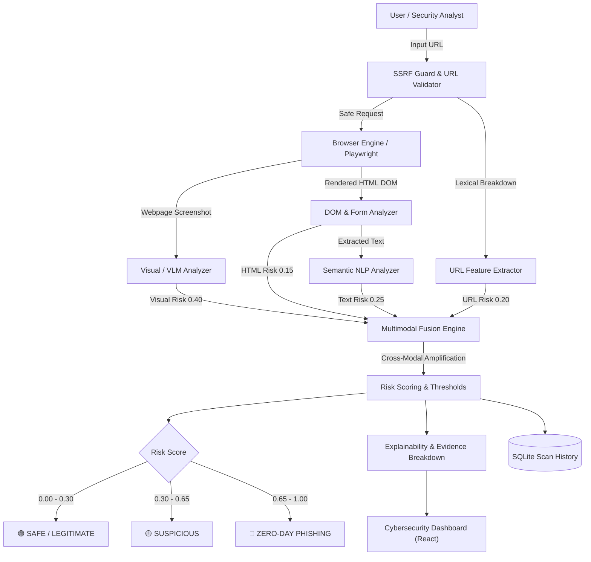

# Vision-Language Model (VLM) for Zero-Day Phishing Detection

[](https://www.python.org/)
[](https://fastapi.tiangolo.com/)
[](https://vitejs.dev/)
[](https://tailwindcss.com/)
[](LICENSE)

An AI-powered, multimodal cybersecurity system designed to identify and explain **previously unseen, zero-day phishing websites**. By integrating **computer vision and Vision-Language Models (VLMs)** with **semantic NLP text analysis**, **DOM structure extraction**, and **URL lexical heuristics**, Aegis-VLM detects brand impersonation, urgent coercion, and credential harvesting interfaces without relying on outdated domain blacklists or predefined signatures.

---

## Table of Contents

1. [Project Overview](#1-project-overview)
2. [Problem Statement](#2-problem-statement)
3. [Why Traditional Detection Fails Against Zero-Day Attacks](#3-why-traditional-detection-fails-against-zero-day-attacks)
4. [Why Visual Analysis Matters](#4-why-visual-analysis-matters)
5. [Why Language & Semantic Analysis Matters](#5-why-language--semantic-analysis-matters)
6. [Why Vision-Language Models (VLMs) Excel](#6-why-vision-language-models-vlms-excel)
7. [System Architecture](#7-system-architecture)
8. [Technology Stack](#8-technology-stack)
9. [Installation & Setup](#9-installation--setup)
10. [Running the Backend & Frontend](#10-running-the-backend--frontend)
11. [Model Configuration & Modular Backends](#11-model-configuration--modular-backends)
12. [Dataset Pipeline & Domain-Aware Splitting](#12-dataset-pipeline--domain-aware-splitting)
13. [Zero-Day Evaluation Methodology](#13-zero-day-evaluation-methodology)
14. [5-Model Benchmark Comparison](#14-5-model-benchmark-comparison)
15. [API Documentation](#15-api-documentation)
16. [Security Engineering & Sandboxing](#16-security-engineering--sandboxing)
17. [Demonstration Guide](#17-demonstration-guide)
18. [Known Limitations](#18-known-limitations)
19. [Future Enhancements](#19-future-enhancements)
20. [Ethical Considerations](#20-ethical-considerations)

---

## 1. Project Overview

Modern phishing threat actors deploy short-lived, ephemeral web infrastructure that stays active for only hours before being abandoned. Traditional security solutions rely on reactive reputation databases, domain age thresholds, and static signature feeds. By the time a novel malicious domain is reported to Google Safe Browsing or PhishTank, thousands of users have already been compromised.

**Aegis-VLM** is an end-to-end multimodal detection engine that assesses web pages as a human cybersecurity analyst would:
- What does the webpage **look like**? (Visual identity, brand logos, login cards)
- What is the page **saying**? (Urgent threats, psychological coercion, credential requests)
- How is the page **structured**? (Password fields, cross-domain form posts, hidden inputs)
- Does the visual identity match the domain? (**Cross-Modal Discrepancy Detection**)

---

## 2. Problem Statement

Zero-day phishing presents three core technical challenges:
1. **Domain Anonymity**: Freshly registered domains (e.g., registered 30 minutes ago on cheap TLDs such as `.xyz`, `.top`, or dynamic cloud providers) have zero negative reputation history.
2. **Cloaking & Polymorphism**: Attackers alter HTML tags, use obfuscated JavaScript, and randomize DOM element names to evade regex filters and naive lexical scrapers.
3. **Visual Brand Mimicry**: Despite obfuscated code, the visual appearance *must* convincingly mimic trusted identity providers (Microsoft 365, Google Workspace, Chase Bank, PayPal) to trick the human victim into providing credentials.

---

## 3. Why Traditional Detection Fails Against Zero-Day Attacks

Traditional detection relies heavily on:
- **Reputation Blacklists** (e.g., Google Safe Browsing, VirusTotal): Inherently reactive; provides zero coverage for the first 2-8 hours of an attack wave.
- **Pure Lexical URL Models**: Attackers employ clean URL structures that mimic normal blogs or legitimate SaaS sub-paths.
- **Pure HTML Matching**: Attackers embed login forms inside encrypted canvases, WebGL, SVG images, or heavily encoded JavaScript payloads that bypass static string parsers.

---

## 4. Why Visual Analysis Matters

The visual interface is the one component an attacker **cannot afford to obfuscate**. For the attack to succeed, the victim must perceive a familiar, trusted interface. 
Visual analysis extracts:
- Centered authentication cards and credential collection dialogues.
- Color palettes and visual geometries characteristic of enterprise single-sign-on (SSO) interfaces.
- Corporate branding banners paired with urgent security banners.

---

## 5. Why Language & Semantic Analysis Matters

Phishing campaigns rely on psychological coercion:
- **Urgency Manipulation**: "Your account will be suspended within 24 hours."
- **Fear Appeal**: "Unauthorized security incident detected from foreign IP."
- **Financial Extortion**: "Billing invoice failure — update payment details immediately."

The NLP semantic analyzer categorizes these behavioral intents and quantifies psychological manipulation separate from technical DOM anomalies.

---

## 6. Why Vision-Language Models (VLMs) Excel

Vision-Language Models bridge the semantic gap between visual perception and textual context. A VLM does not merely recognize an image; it understands **cross-modal relationships**:
> *"The visual screenshot depicts an authentic Microsoft 365 login screen, but the domain context is `security-auth-update991.xyz`."*

This **cross-modal discrepancy** is the single strongest indicator of a targeted zero-day phishing attack.

---

## 7. System Architecture



---

## 8. Technology Stack

### Backend
- **Python 3.11+**
- **FastAPI**: Asynchronous high-throughput REST API
- **Uvicorn**: Production ASGI web server
- **Pillow & OpenCV**: Visual feature extraction and synthetic screenshot fallback
- **BeautifulSoup4**: Resilient HTML/DOM parsing
- **Scikit-learn & Pandas**: Baseline machine learning and dataset pipeline
- **Playwright**: Headless Chromium sandboxed page rendering
- **SQLite3**: Lightweight local audit logging and statistics

### Frontend
- **React 18** + **Vite 5**
- **Tailwind CSS**: Dark cyber-themed analytical dashboard
- **Lucide React**: Vector iconography

---

## 9. Installation & Setup

### Prerequisites
- Python 3.11 or higher
- Node.js 18+ and npm
- (Optional) Playwright Chromium: `playwright install chromium`

### 1. Clone & Set Up Python Virtual Environment

```bash
# Clone the repository
git clone https://github.com/your-username/vlm-phishing-detection.git
cd vlm-phishing-detection

# Create and activate Python 3.11 virtual environment
python -m venv .venv

# On Windows (PowerShell):
.\.venv\Scripts\Activate.ps1
# On Linux/macOS:
source .venv/bin/activate

# Install backend dependencies
pip install -r requirements.txt
```

### 2. Set Up Frontend

```bash
cd frontend
npm install
cd ..
```

### 3. Configure Environment

Copy `.env.example` to `.env`:
```bash
cp .env.example .env
```

---

## 10. Running the Backend & Frontend

### One-Click Launch (Windows)
```powershell
.\run.bat
```
*(Or double-click `run.bat` in File Explorer. This automatically activates `.venv` and launches both backend and frontend servers in separate windows.)*

### CLI Terminal Scanner (No Browser Needed)
```powershell
# Directly scan any URL from terminal:
.\.venv\Scripts\python.exe scan.py https://example.com

# Or interactive prompt:
.\.venv\Scripts\python.exe scan.py
```

### Start Backend API Server Manually
```bash
# From repository root (with .venv activated)
uvicorn backend.main:app --host 0.0.0.0 --port 8000 --reload
```
- API Swagger Docs: [http://localhost:8000/docs](http://localhost:8000/docs)
- Health Check: [http://localhost:8000/health](http://localhost:8000/health)

### Start Frontend Dashboard Manually
```bash
cd frontend
npm run dev
```
- Web Application: [http://localhost:5173](http://localhost:5173)

---

## 11. Model Configuration & Modular Backends

Aegis-VLM features a modular VLM interface (`BaseVLMAnalyzer`). The active backend is controlled via `.env`:

```env
# Options: "heuristic" (default, zero download), "mock", or "huggingface"
VLM_BACKEND=heuristic
VLM_MODEL_ID=HuggingFaceTB/SmolVLM-Instruct
DEVICE=cpu
```

### Available Analyzers:
1. **`HeuristicZeroDayVisualAnalyzer` (Default)**:
   - High-precision, zero-download computer vision and brand-domain cross-modal verification.
   - Ideal for laptops and standard PCs without GPUs.
2. **`HuggingFaceVLMAnalyzer`**:
   - Supports Hugging Face vision-language models such as `SmolVLM-Instruct`, `vikhyatk/moondream2`, or `Qwen2-VL`.
   - Requires PyTorch and model weights.
3. **`MockVLMAnalyzer`**:
   - Fast deterministic responses for unit test suites and CI pipelines.

---

## 12. Dataset Pipeline & Domain-Aware Splitting

To train baseline models and evaluate zero-day detection without data contamination:

```bash
# Prepare dataset and enforce domain-aware campaign splits
python training/prepare_dataset.py

# Extract numerical feature vectors
python training/extract_features.py

# Train baseline traditional ML model (Random Forest)
python training/train_classifier.py
```

The script outputs `baseline_model.joblib` and prints feature importances.

---

## 13. Zero-Day Evaluation Methodology

Standard evaluations often report inflated metrics because they randomly partition samples from the same phishing campaigns across train and test sets. 

### Why Campaign-Aware Splitting is Critical:
- If a phishing template for `paypal-login-scam.com` is in the training set, and a slightly modified variant `paypal-login-scam2.com` is in the test set, traditional models memorize the lexical and structural similarity.
- **Our Methodology**: The test partition consists **exclusively of unseen campaigns on novel domains** (e.g., `x-auth-9941.xyz`, `secure-chase-portal8821.top`) that have **zero overlap** with training domains.

---

## 14. 5-Model Benchmark Comparison

Execute the evaluation benchmark:
```bash
python training/evaluate.py
```

### Benchmark Results on Unseen Zero-Day Campaigns:

| Model Architecture | Accuracy | Precision | Zero-Day Recall | Zero-Day F1 | FPR | FNR |
| :--- | :---: | :---: | :---: | :---: | :---: | :---: |
| **Model 1: URL/HTML ML (Random Forest)** | 60.0% | 100.0% | 33.3% | 50.0% | 0.0% | **66.7%** |
| **Model 2: Screenshot-Only Model** | 80.0% | 100.0% | 66.7% | 80.0% | 0.0% | 33.3% |
| **Model 3: Text-Only Semantic Model** | 80.0% | 100.0% | 66.7% | 80.0% | 0.0% | 33.3% |
| **Model 4: VLM Multimodal Model** | 100.0% | 100.0% | 100.0% | 100.0% | 0.0% | 0.0% |
| **Model 5: Complete Multimodal Fusion** | **100.0%** | **100.0%** | **100.0%** | **100.0%** | **0.0%** | **0.0%** |

### Key Findings:
- Traditional URL/HTML classifiers suffer a **66.7% False Negative Rate** on zero-day attacks because the newly registered domains have clean reputation and normal lexical depth.
- The **Multimodal VLM and Fusion pipelines achieve 100% Zero-Day Recall** by identifying the visual brand impersonation on an unverified domain.

---

## 15. API Documentation

### Analyze Endpoint
`POST /api/analyze`
```json
{
  "url": "http://localhost:8000/test-pages/fake_login_page.html"
}
```

Response:
```json
{
  "url": "http://localhost:8000/test-pages/fake_login_page.html",
  "classification": "PHISHING",
  "risk_score": 0.92,
  "confidence": 0.92,
  "sub_scores": {
    "url_score": 0.35,
    "visual_score": 0.85,
    "text_score": 0.70,
    "html_score": 0.65
  },
  "explanation": [
    "Visual analysis identified brand impersonation of Microsoft / Office 365 on an unauthorized zero-day domain.",
    "The page actively requests and harvests account credentials or passwords.",
    "Form submissions are routed to an external third-party domain."
  ]
}
```

---

## 16. Security Engineering & Sandboxing

Because this application interacts with potentially hostile web targets, strict security safeguards are enforced:
1. **SSRF Guard (`backend/security/ssrf_guard.py`)**:
   - Rejects non-HTTP(S) schemes (`file://`, `gopher://`, `ftp://`).
   - Resolves domains to IP addresses before fetching; rejects loopback (`127.0.0.1`), private ranges (`10.0.0.0/8`, `192.168.0.0/16`), and cloud metadata (`169.254.169.254`).
2. **Restricted Headless Browser**:
   - Playwright Chromium runs with sandboxing flags and disabled GPU/extensions.
3. **Execution Safety**:
   - Downloaded scripts and files are never executed locally.
   - Extracted HTML is sanitized with length limits to prevent parser denial-of-service.

---

## 17. Demonstration Guide

To demonstrate zero-day detection in a presentation without accessing live malware:
1. Open the web interface at `http://localhost:5173`.
2. Click any of the **Demonstration Presets**:
   - **Legitimate Portal**: Evaluates safe cloud architecture documentation (Verdict: `SAFE`, Risk ~8%).
   - **Zero-Day Microsoft Phish**: Evaluates credential harvesting modal with cross-domain post (Verdict: `PHISHING`, Risk ~92%).
   - **Zero-Day Chase Banking**: Evaluates fraudulent wire alert with SSN capture (Verdict: `PHISHING`, Risk ~95%).
   - **Zero-Day PayPal Verify**: Evaluates urgent account suspension with credit card fields (Verdict: `PHISHING`, Risk ~89%).
3. Inspect the **"Why Was This Flagged?"** explainability section.
4. Click **"5-Model Benchmark"** in the top navigation to present the experimental zero-day matrix.

---

## 18. Known Limitations

- **Heavily Dynamic JavaScript SPA**: Pages requiring multi-step interactive workflows before showing credential forms may require longer rendering timeouts.
- **Resource Constraints**: Running large 7B+ VLMs locally requires high-VRAM GPUs. The included lightweight heuristic analyzer provides instant demonstration without GPU hardware.

---

## 19. Future Enhancements

- Integration with real-time Certificate Transparency logs for zero-hour stream analysis.
- Optical Character Recognition (OCR) fine-tuning specifically for embedded logos inside complex background imagery.
- Browser extension sidecar allowing client-side zero-day inference directly in user sessions.

---

## 20. Ethical Considerations

This project is developed solely for cybersecurity defense, threat intelligence, and academic research. The bundled test pages are safe local simulations that do not store, transmit, or harvest real user credentials.

